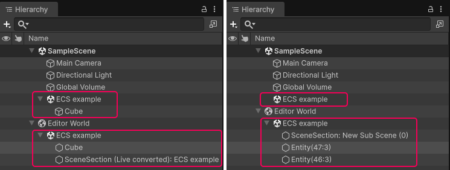
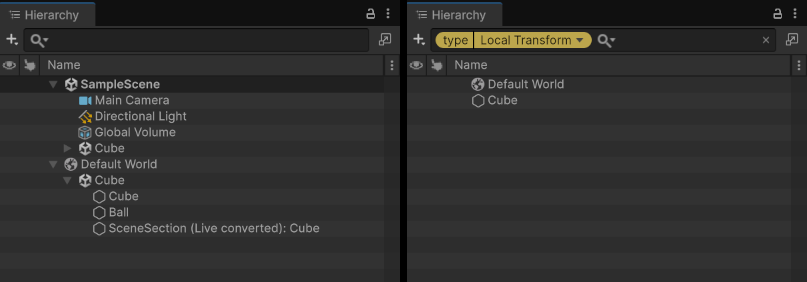

# Entity world view in Hierarchy window

[Entity worlds](concepts-worlds.md) are visible in the Hierarchy window. Each entity world node contains the converted [subscenes](conversion-subscenes.md) and [entities](concepts-entities.md) that belong to that world.

World nodes always appear below all Scene nodes in the Hierarchy.

## World node overview

A World node contains the following child nodes:

* **Subscene nodes** display the subscene asset name and use the Unity scene icon. Entities that belong to a subscene are displayed as children of the corresponding subscene node.
* **Entity nodes** display the entity name and use the entity icon. Entities with a [Parent](xref:Unity.Transforms.Parent) component appear nested under their parent entity, which reflects the ECS [transform hierarchy](transforms-concepts.md). Entities that don't belong to any subscene appear directly under the world node.

All entity-related nodes (world, subscene, and entity nodes) are read-only in the Hierarchy window. You can't rename, cut, copy, paste, duplicate, delete, or drag-and-drop these nodes.

In Edit mode, the entity world node has the name **Editor World**, and in Play mode, **Default World**.

When the authoring subscene is open, the Hierarchy window displays converted entities with names that match the authoring GameObjects. When the subscene is closed, those entities have the name Entity followed by the index and version in brackets.

 _Hierarchy view when the subscene is open (left), and closed (right)_

To view information about an entity, select it in the Hierarchy. The [Inspector](editor-entity-inspector.md) displays the entity's data.

### Entity prefabs

Entity prefab root nodes display an entity prefab icon and a blue name. Entity prefab part nodes (children within a prefab) also display blue names but use the standard entity icon. For more information about entity prefabs, refer to [Entity prefabs](baking-prefabs.md).

### Hidden entities

Some entities exist to handle internal Unity states and don't appear in the Hierarchy window. Unity adds the `HideInHierarchy` tag component to such entities. To display them, enable **Show Hidden Entities** in **Preferences** > **Entities** > **Hierarchy Window**.

## Search for entities

The search field in the Hierarchy window toolbar filters entity nodes as well as GameObjects. Text that you type matches the names of both.

To filter entities by the ECS components they have, use the `t:` filter token, followed by a component type name:

|**Filter**|**Result**|
|---|---|
|`t:LocalTransform`|Entities that have a [`LocalTransform`](xref:Unity.Transforms.LocalTransform) component.|
|`t:Unity.Transforms.LocalTransform`|The same result, written as a full type name. Use the full name to distinguish between component types that share a short name.|
|`t:LocalTransform t:LocalToWorld`|Entities that have both components. Every token you add narrows the result further.|
|`t:LocalTransform Cube`|Entities that have a `LocalTransform` component and whose name contains `Cube`.|

The token matches [components](concepts-components.md), [shared components](components-shared.md), and [dynamic buffers](components-buffer.md). Short type names aren't case-sensitive, and you can write the token with either `:` or `=`, so `t=localtransform` gives the same result as `t:LocalTransform`. If you enter a type name that no component matches, the Hierarchy window displays no results.

To select a component type instead of typing its name, select the filter dropdown at the left of the search field, or press Tab while the search field has focus, and then select a type under **Components**. This dropdown is available when **Enable Query Builder** is on in **Edit** > **Preferences** > **General**.

 _Hierarchy view with no filter (left), and with the `t:LocalTransform` filter (right)_

Selecting **See all** in the [System Inspector](editor-system-inspector.md) also creates a query in this search field, which then displays the entities that a system's query matches.

## Open and close a subscene

To open or close a subscene from the Hierarchy window, right-click the subscene node under its scene and select **Open** or **Close**, or double-click the node to switch between the two states. For more information, refer to [Subscene component](conversion-subscenes.md#subscene-component).

## Entity world display preferences

To configure how entities appear in the Hierarchy, go to **Preferences** > **Entities** > **Hierarchy Window**. For more information, refer to [Entities Preferences reference](editor-preferences.md).

## Additional resources

* [World concepts](concepts-worlds.md)
* [Entity Inspector reference](editor-entity-inspector.md)
* [Entities Preferences reference](editor-preferences.md)
* [Subscenes overview](conversion-subscenes.md)
