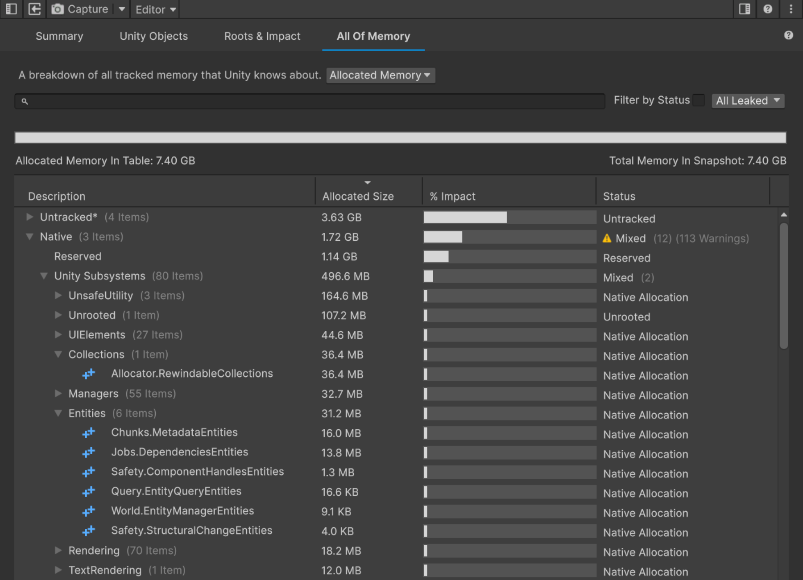

# Entities memory labels

Unity assigns a [memory label](xref:um-performance-unmanaged-memory) to each unmanaged memory allocation it makes. A label indicates the area of Unity that an allocation belongs to and what it contains. ECS assigns labels to its own unmanaged allocations the same way, in three areas, `Entities`, `EntitiesGraphics`, and `Collections`, so you can see how much memory ECS uses and which part of ECS each allocation belongs to.

The labels don't cover component data or the native containers that project code allocates. For more information, refer to [Limitations of the memory labels](#memory-label-limitations).

## View the labeled allocations

Memory labels appear in the **Memory Profiler** window, which the [Memory Profiler package](https://docs.unity3d.com/Packages/com.unity.memoryprofiler@latest/) adds to the Unity Editor. To see the labels, follow these steps:

1. Open **Window** > **Analysis** > **Memory Profiler**.

2. Capture a snapshot of the Editor or of a connected development build, then open it.

3. Select the **All Of Memory** tab.

4. Expand **Native** > **Unity Subsystems**.

Each area has its own row. Expand an area row to display one row for each label in that area, with the memory allocated under that label. In the **Description** column, a label row shows the object name directly followed by the area name. For example, the `Chunks.Metadata` label in the `Entities` area appears as **Chunks.MetadataEntities**.

A project that uses Entities and Entities Graphics has three area rows: **Entities**, **EntitiesGraphics**, and **Collections**. By default, the table sorts rows by size, so these three rows are usually not next to each other.

 _The Collections and Entities area rows expanded in the All Of Memory tab_

> [!NOTE]
> This is a different tool from the [Entities Memory Profiler module](profiler-module-memory.md), which reports the memory that archetypes use per frame in the Profiler window.

## Memory label reference

The following table lists the memory labels that ECS assigns.

| **Area** | **Object** | **Contents** |
| --- | --- | --- |
| `Collections` | `Allocator.Rewindable` | The memory blocks that a rewindable allocator allocates, which includes every [world update allocator](allocators-world-update.md). |
| `Entities` | `World.EntityManager`| The data access struct behind each [world](concepts-worlds.md). |
| `Entities` | `Chunks.Metadata`| The array that records which archetype each chunk belongs to. |
| `Entities` | `Query.EntityQuery`| The backing storage of each [entity query](systems-entityquery-intro.md). |
| `Entities` | `Jobs.Dependencies`| The arrays that record which scheduled jobs read or write each component type. Entities uses these arrays to track [system dependencies](scheduling-jobs-dependencies.md). |
| `Entities` | `Safety.ComponentHandles`| The safety handles for component access. |
| `Entities` | `Safety.StructuralChange`| The list of queries that `foreach` loops are currently going through. The safety checks use this list to detect a [structural change](concepts-structural-changes.md) that affects the entities in one of those loops. |
| `Entities` | `Allocator.Scratchpad`| The memory of each thread's [`ScratchpadAllocator`](xref:Unity.Entities.ScratchpadAllocator). Its allocations stay valid until code calls the [`Rewind`](xref:Unity.Entities.Scratchpad.Rewind*) method of the [`Scratchpad`](xref:Unity.Entities.Scratchpad) struct. That call frees all of the allocations at once. |
| `EntitiesGraphics` | `Rendering.SparseUploader`| The per-thread data that batches uploads to GPU buffers. |
| `EntitiesGraphics` | `Rendering.System`| The per-thread statistics of the Entities Graphics system. This row only appears in Editor snapshots. |

## Limitations of the memory labels

The labels cover the memory that ECS allocates for its internal data structures, not the memory that stores component data or the contents of native containers:

* **Component data has no label**: Entities stores component data in chunks, which are blocks of memory that each hold the entities of one [archetype](concepts-archetypes.md). The chunks have no label, so the Memory Profiler doesn't report how much memory an archetype uses. The `Chunks.Metadata` label only covers the array that records which archetype each chunk belongs to, not the chunks themselves. To measure the memory that archetypes use, use the [Entities Memory Profiler module](profiler-module-memory.md).
* **Native containers that project code allocates have no ECS label**: For example, a `NativeArray<T>` struct allocated with the `Allocator.Persistent` enum value appears under **Unity Subsystems** > **UnsafeUtility** instead.
* **The allocated size can include memory that ECS doesn't use yet**: ECS allocates some memory blocks at their full size in advance and fills them over time. For example, Entities allocates the `Chunks.Metadata` array for the maximum number of chunks when it initializes, so that label reports about 16 MB regardless of how many chunks exist.

Unity only creates memory labels in the Editor and in development builds. A snapshot from a release build has no ECS rows under **Unity Subsystems**.

## Additional resources

* [Unmanaged memory](xref:um-performance-unmanaged-memory)
* [Memory Profiler package](https://docs.unity3d.com/Packages/com.unity.memoryprofiler@latest/)
* [Entities Memory Profiler module reference](profiler-module-memory.md)
* [Memory allocators](memory-allocators.md)
